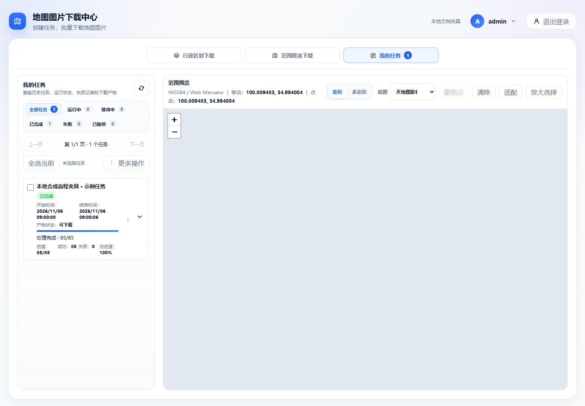
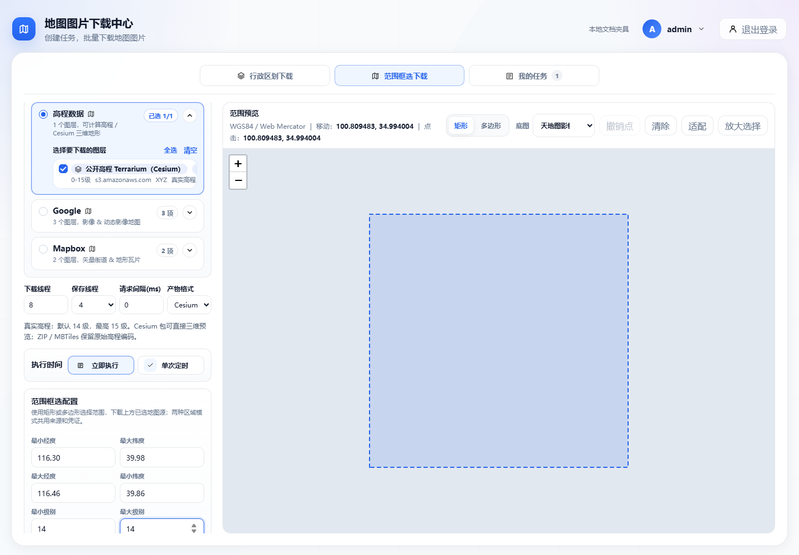

# Map Tile Fetcher

自托管地图与高程下载器。使用 Go、SQLite 和静态前端，按行政区、矩形或多边形下载地图，输出 ZIP、MBTiles 或可由 Cesium 加载的离线地形包。

A self-hosted map and elevation downloader built with Go and SQLite. Select an administrative region, rectangle or polygon; export map tiles as ZIP/MBTiles or elevation as offline Cesium terrain.



## 快速启动

源码需要 Go **1.27.3**、Node **24.22.2** 和 npm。版本由应用 `go.mod`、根目录 `.node-version` 和 `package-lock.json` 固定。

```powershell
git clone https://github.com/Joe5027/map-tile-fetcher.git
cd map-tile-fetcher/apps/admin-region-tiler
npm ci --omit=dev --no-audit --no-fund
go run .
```

打开 `http://127.0.0.1:8081/`。本地开发默认账号为 `admin` / `adminmap`。
首次部署前通过进程环境 `AUTH_DEFAULT_USERNAME`、`AUTH_DEFAULT_PASSWORD` 设置初始账号；已有用户通过页面修改密码，修改初始化配置不会重置旧密码。
源码和原生程序不自动读取 `.env`，Docker Compose 会注入它。

原生安装包解压后直接运行 `tiler.exe` 或 `./tiler`，不需要 Go、Node 或 Python。
保留同目录的 `conf.toml`、`static/` 和 `geojson/`。详见[构建与安装](docs/build-and-install.md)和[密码恢复](docs/password-recovery.md)。

## 当前能力

- **统一区域与来源**：行政区、矩形、多边形共用来源目录，支持地图影像、注记、地形底图、矢量瓦片和公开 Terrarium 高程。
- **真实高程**：选择 Terrarium 和 Cesium 输出，生成 `layer.json` 与 gzip `.terrain`，自动补齐祖先和采样所需邻接数据。默认最大级别 14，可选 15。
- **离线三维预览**：本地 Cesium 资源按需加载，不需要 ion 或在线底图。地形底图图片、Mapbox 地形矢量和真实高程在界面中区分。
- **异常自动续传**：服务恢复后继续原运行，只补缺失或损坏瓦片；手动暂停保持暂停。暂停释放执行槽，恢复按队列容量执行。
- **累计产物**：失败重试复用旧成功结果；新产物成功发布前，旧下载入口继续可用。
- **明确进度**：准备、下载、转换、校验、打包和发布分别反馈。每页 50 个父任务，后台更新保留选择、焦点和展开状态。
- **实际参数生效**：两种创建方式提交相同下载参数，显示来源限制后的并发与间隔。来源重试策略、零重试和 WebP 均有回归测试。
- **准确限额**：默认每父任务全部来源累计 100 万个唯一请求；复杂区域按实际去重数量判定，外包矩形仅作估算。默认同时执行 3 个子任务，可配置。



地图服务仍需使用你有权下载的数据和凭证。公开高程首版定位离线三维展示，固定 65×65 网格经过采样及量化，不是无损 DEM，也不执行工程高程基准转换。

## Docker

```powershell
cd apps/admin-region-tiler
Copy-Item .env.example .env
# 按本地环境填写账号、端口和路径。
docker compose up --build -d
```

数据保存在持久目录；升级前备份数据库和输出，先在副本验证。不要把运行数据、真实 token 或安装包提交到 Git。

## 使用与维护入口

| 需要做什么 | 入口 |
| --- | --- |
| 创建、暂停、续传、重试、预览、下载 | [中文手册](docs/user-manual-zh.md) / [English manual](docs/user-manual.md) |
| 离线高程格式与服务示例 | [Cesium 地形说明](docs/terrain.md) |
| 源码配置与验证 | [应用 README](apps/admin-region-tiler/README.md) |
| Windows/Linux 安装包与 Docker | [构建与安装](docs/build-and-install.md) |
| 区域维护与现存数据缺口 | [区域维护](docs/region-maintenance.md) / [边界调查](docs/region-gap-investigation-2026-09-11.md) |
| 升级、性能证据和未验证范围 | [升级记录](docs/upgrade-2026-11.md) |
| 提交前逐项核对实施计划 | [计划覆盖与验收](docs/plan-acceptance-2026-11.md) |
| 依赖升级/保留理由 | [依赖评审](docs/dependencies-2026-11.md) |
| Agent 快速接手 | [项目地图](docs/project-map.md) → [完成定义](docs/done-definition.md) → [协作手册](docs/ai-operating-handbook.md) |

## English quick guide

Run `npm ci --omit=dev` and `go run .` from `apps/admin-region-tiler`, then open
port 8081. Native packages include all frontend assets and need no Node runtime.
Use the shared source catalogue for every region mode. Select Terrarium plus
Cesium output for elevation; ZIP/MBTiles remain available for imagery/vector
tiles. Terrain level 14 is the default, with level 15 available.

Interrupted work resumes automatically using committed output. Explicitly
paused work stays paused and releases its execution slot. Retry requests queue
promptly; the worker validates and copies the baseline once. Published output
stays available until its replacement succeeds. History uses paginated batch
queries, and refresh preserves interaction state.

Read the [English manual](docs/user-manual.md) for configuration and recovery,
and the [terrain guide](docs/terrain.md) for projection, sampling, offline serving
and accuracy limits. Use authorized sources; terrain output is intended for 3D
visualization, not surveying or flight-safety decisions.

## 开发验证

```powershell
cd apps/admin-region-tiler
npm ci --no-audit --no-fund
npx playwright install chromium
go test ./...
go vet ./...
node scripts/smoke_ui.mjs
node ../../scripts/check_docs.mjs
```

完整发布预检、Linux race、Python 区域工具和安装包验证见[验证链路](docs/validation-chain.md)。
每批变更同步文档并提交双语 commit。`main` 是唯一长期分支；其他分支的有效工作整合、验证并同步后，再清理本地和远程分支，见 [AGENTS.md](AGENTS.md)。

许可证：[Apache License 2.0](LICENSE)。旧 .NET 下载器仅保留[迁移历史](docs/range-migration.md)。
