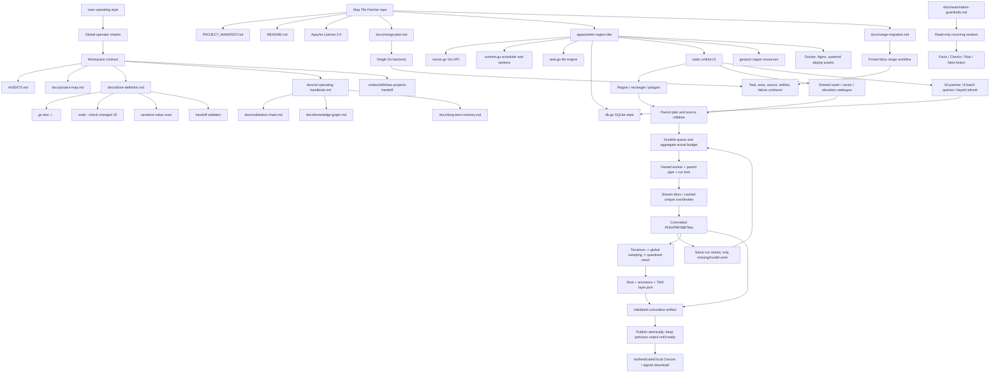

# Knowledge Graph

This graph captures durable relationships future AI sessions should recover
before making release, cleanup, or validation decisions.

## Relationship Notes

- Current user authorization and `AGENTS.md` govern actions. Project facts
  belong in this repository, not in global `.codex` docs; historical notes do
  not grant permission for a new deployment or external write.
- `docs/ai-operating-handbook.md` is the compact route for repository-local AI
  enhancement and control-surface work.
- `docs/project-map.md` is the first durable context packet for future sessions.
- `docs/long-term-memory.md` carries restart-ready state for long-running merge
  or cleanup work, including AI-control tranches.
- `apps/admin-region-tiler` is the single runtime application.
- The old .NET range downloader is represented only by
  `docs/range-migration.md`.
- Validation is Go and frontend-script specific. Do not replace `go test` or
  changed-JS `node --check` with generic prose review when the commands can run.
- Raw elevation cache is the retry/recovery baseline; the terrain mesh directory
  is a derived artifact. Mesh integrity and raw source coverage are different
  counts and must not overwrite each other's coordinates.
- A manual pause is durable intent, while a killed service is recoverable
  execution. Queue capacity applies when resuming too; paused work releases slots.
- Geometric bounding boxes provide estimates. Complex/overlapping regions use
  actual unique coordinates before reserving the parent budget.
- `go.mod`, `.node-version`, `package-lock.json` and the Python wheel hash lock
  feed CI and packaging; [dependency decisions](dependencies-2026-11.md) explain
  why versions changed or stayed.
- [Upgrade evidence](upgrade-2026-11.md) separates measured fixture results,
  browser interoperability, native packages and production verification.
