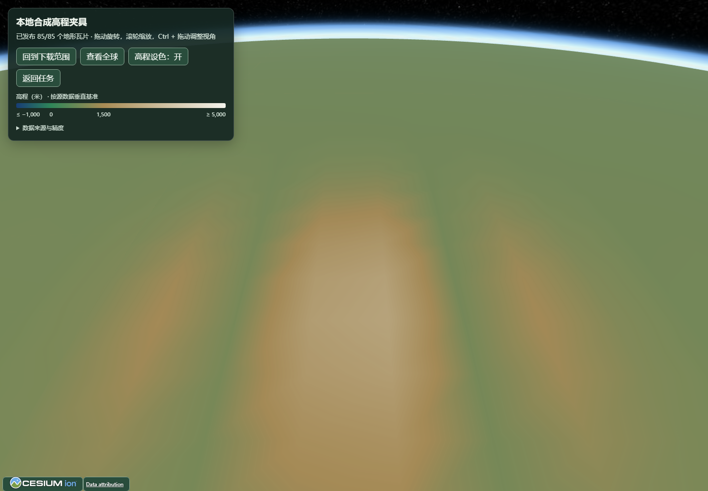
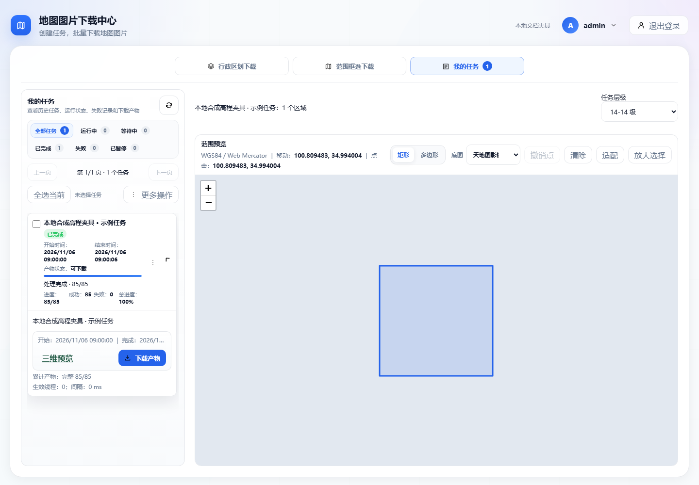

# 离线 Cesium 高程 / Offline Cesium terrain

## 选择正确的数据

| 目的 | 来源与产物 |
| --- | --- |
| 带地貌色彩的二维地图 | 地形底图与注记，输出 ZIP/MBTiles |
| 地形相关矢量要素 | Mapbox 地形矢量，保留 PBF；不包含可直接显示三维地表的高程网格 |
| 离线三维地表 | 公开 Terrarium 高程，输出 Cesium 地形 ZIP |

默认高程源是 AWS 公共数据目录的 Terrain Tiles，不要求 AWS 账号。
源为 256×256 Terrarium PNG，支持至 15 级；应用默认最大级别 14。
访问可用性仍取决于本地网络，断网下载不会凭空成功。
[AWS 数据目录](https://registry.opendata.aws/terrain-tiles/)与[服务格式](https://github.com/tilezen/joerd/blob/master/docs/use-service.md)说明了数据来源及层级。

区域选择与来源独立：行政区、矩形、多边形都可以使用同一高程源。
Cesium 输出只接受 Terrarium 编码的 XYZ PNG；普通图片不能当作高程解码。

## 下载、转换与恢复

1. 选择范围、Terrarium 来源、Cesium 输出及层级，查看页面摘要后创建。
2. 准备阶段计算唯一原始请求，包括所选网格、全部祖先和边界采样邻域。
3. 下载保留原始 PNG；转换使用全球一致的像素中心采样生成 65×65 网格。
4. 校验可用祖先链，生成 `layer.json`、gzip `.terrain`、来源署名和服务说明，再打包发布。
5. 从子任务打开三维预览，或下载 ZIP 用于其他 Cesium 应用。

应用内预览按需绘制：静止时避免持续重绘，移动视角、加载新瓦片和切换高程设色时更新。
保留原有画质与网格精度，减少闲置 CPU/GPU 占用。

创建前的矩形估算已包含所有祖先和邻接采样请求，并分别显示原始请求与网格数量。
多边形使用外接矩形保守估算，准备阶段按实际去重范围计数后执行限额；不因保守估算而拒绝有效任务。

已保存的原始 PNG 和完整网格可跨服务重启复用。手动暂停保持暂停；恢复需要可用执行槽。
缺源记录为失败，允许已有父级回退和后续重试；不会把失败数据替换为零高程。
零米和负高程本身是合法数据。根网格不可用时不发布新包，保留旧产物入口。

## 格式与精度

- `format: quantized-mesh-1.0`，投影 `EPSG:3857`，TMS 行号，一个零级根瓦片。
- 原始下载是 XYZ；产物路径是 `{z}/{x}/{tmsY}.terrain`，两者不能混用。
- `available` 只列完整网格及有效祖先链；不会把整个选框虚报为已完成。
- 网格固定 65×65，按 Mercator 全球坐标取样；每瓦片高度再量化为 15 位。
- 共享采样边界一致，但独立瓦片的量化范围可产生微小高度差，Cesium 使用边缘裙边处理显示接缝。
- 来源可能具有不同分辨率和垂直参考。本工具不做垂直基准变换、不输出无损原始 DEM，也不用于工程测量或航线安全计算。

编码细节遵循[quantized-mesh 规范](https://github.com/CesiumGS/quantized-mesh/blob/main/SPECIFICATION.md)。
全球 Mercator 根及个别粗层无法构造有限的保守 horizon 点；编码器在这些瓦片使用
NaN 禁用该可选遮挡判断。实际验收目标为锁定的 Cesium 1.147，其他引擎需要单独验证。

## 离线预览与静态服务

应用内预览从 `static/vendor/cesium/` 加载本地资源，关闭 ion、在线影像和在线地名搜索。
源码开发先运行 `npm ci`，原生包和 Docker 构建已包含这些资源。未准备资源时应重新运行
安装命令；无需填写 ion Token。预览仍需要本地 HTTP 服务，直接双击 `layer.json` 不会启动地形浏览器。
默认显示高程色带和米制图例，可切换为纯色。色带范围固定，超出范围的高度使用端点颜色；
这只改变显示，不改变下载高程或网格。文档预览图片使用明确标注的本地合成高程夹具。





下载 ZIP 包含地形和来源说明，`README.txt` 内提供 Nginx 配置片段与 Cesium 加载示例。将包解压到本地 HTTP
服务目录，再把你已有的本地 Cesium 资源与示例配合使用；ZIP 不重复捆绑整套 Cesium。
需要完全断网部署时，可复制应用的 `static/vendor/cesium/`，同时保留其许可证和署名。

`.terrain` 文件已经 gzip 压缩：服务器应返回
`Content-Type: application/vnd.quantized-mesh` 和 `Content-Encoding: gzip`，不得再次压缩。
`layer.json` 使用 JSON 类型。跨端口/域加载时按实际页面来源配置 CORS；应用内同源预览无需额外配置。
使用产物内附带的服务器示例，普通 `python -m http.server` 不会自动为 `.terrain` 设置 gzip 头。

```javascript
// Cesium.js、Workers、Assets、Widgets 均来自你部署的本地 Cesium 目录。
const terrainProvider = await Cesium.CesiumTerrainProvider.fromUrl("./terrain/");
const viewer = new Cesium.Viewer("viewer", {
  terrainProvider,
  baseLayer: false,
  baseLayerPicker: false,
  geocoder: false
});
```

来源署名随产物导出；详细上游署名见 [Tilezen attribution](https://github.com/tilezen/joerd/blob/master/docs/attribution.md)。
自定义来源应填写自己的编码、投影、有效层级和署名；导出元数据不应包含访问 token。

## 验证与界限

Go 测试独立解析量化网格，覆盖已知/负/零高程、Mercator 纬度、三角形、边界、TMS、祖先、缺片、压缩与恢复。
真实 worker 测试使用本地 PNG 夹具；浏览器使用真正生成的网格和本地 Cesium，并阻止所有外网请求。
当前执行结果、平台检查和尚未执行的项目统一记入[升级记录](upgrade-2026-11.md)，不把模拟数据验证表述为真实区域测绘验收。

English: choose public Terrarium elevation and Cesium output, then preview the
child artifact or download its ZIP. The package is EPSG:3857/TMS quantized-mesh
with one root, complete ancestors, 65×65 sampling and gzip payloads. Serve the
included files over HTTP with the supplied compression headers, and use local
Cesium assets. The built-in preview renders on demand while retaining normal
camera, tile-loading and elevation-color updates. Missing data remains missing; source accuracy and vertical datum
are preserved as limitations rather than claimed survey-grade guarantees.
